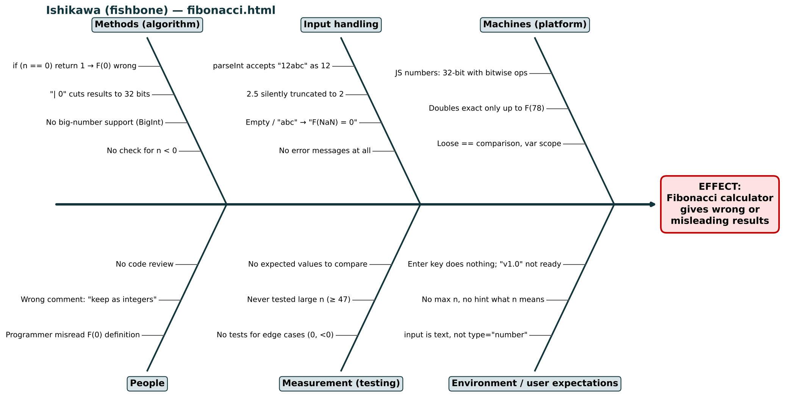
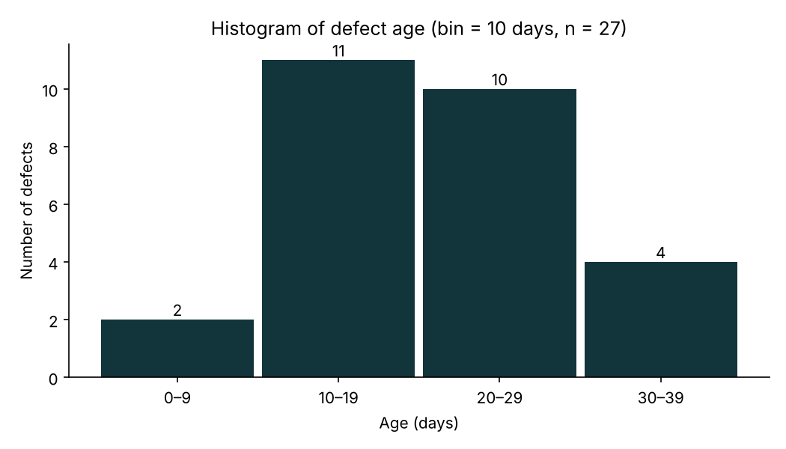
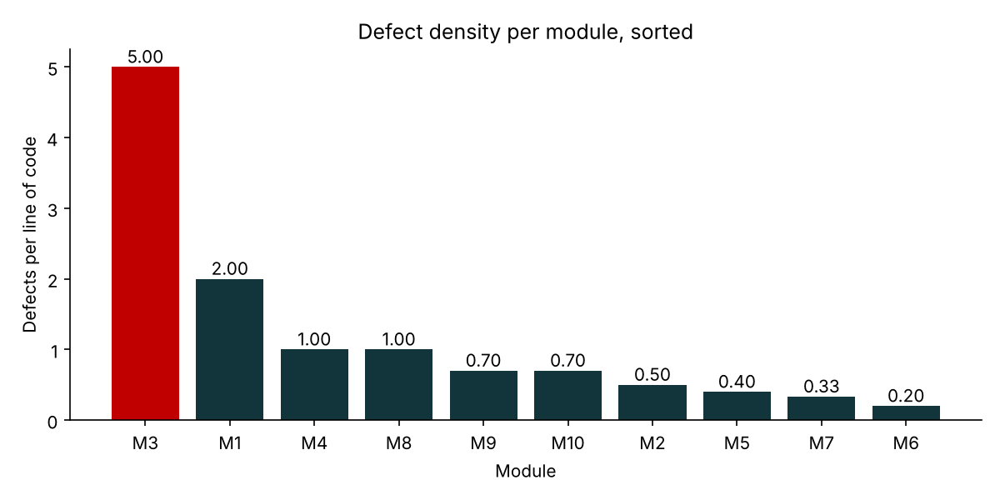

# Lab 4 – Quality tools and Git

Systems Engineering · Politehnica University of Bucharest, FILS

| File | Content |
|---|---|
| `fibonacci_original.html` | The program we tested (Exercise 1) |
| `fibonacci_fixed.html` | Corrected version of the program |
| `Lab4_defect_data_solved.xlsx` | Exercises 1–3 solved in Excel (formulas + charts) |
| `defect_analysis.py` | Python code for exercises 2–3: computes ages, histogram, densities and draws the charts (`python defect_analysis.py`) |
| `images/` | Fishbone diagram, histogram, defect density chart |

---

## Exercise 1 – Ishikawa diagram for the Fibonacci program

### Test results

Correct values: F(0) = 0, F(1) = 1, F(n) = F(n-1) + F(n-2).

| Input | Program shows | Correct F(n) | OK? | What is wrong |
|---|---|---|---|---|
| 0 | F(0) = 1 | 0 | ❌ | `if (n == 0) return 1` is wrong |
| 1 | F(1) = 1 | 1 | ✅ | |
| 15 | F(15) = 610 | 610 | ✅ | |
| 23 | F(23) = 28657 | 28657 | ✅ | |
| 50 | F(50) = -298632863 | 12586269025 | ❌ | `\| 0` forces 32-bit integers → overflow from n = 47 |
| 98 | F(98) = -90618175 | 135301852344706746049 | ❌ | Overflow; normal JS numbers are also not exact after F(78) |
| -5 | F(-5) = 0 | error expected | ❌ | Negative n accepted, no message |
| 2.5 | F(2) = 1 | error expected | ❌ | `parseInt` cuts 2.5 to 2 silently |
| abc | F(NaN) = 0 | error expected | ❌ | No input validation |
| 12abc | F(12) = 144 | error expected | ❌ | `parseInt` accepts "12abc" as 12 |
| (empty) | F(NaN) = 0 | error expected | ❌ | Empty input not checked |

**Correctness:** only 3 of 11 tests pass. **Performance:** fast (simple loop), but large n gives wrong results. **Ease of use:** no label explaining n, Enter key does nothing, no error messages. **Source code:** misleading comment ("keep the numbers as integers"), `var` and loose `==`, labelled "version 1.0" although it is not ready. **User expectations:** the user expects either a correct number or a clear error, never a negative Fibonacci number or "NaN".

### Fishbone

Effect: **the Fibonacci calculator gives wrong or misleading results.**

| Category | Causes |
|---|---|
| Methods (algorithm) | F(0) special case wrong; `\| 0` cuts results to 32 bits; no BigInt; no check for n < 0 |
| Input handling | `parseInt` accepts "12abc"; 2.5 truncated to 2; empty / "abc" → NaN; no error messages |
| Machines (platform) | JS bitwise operations are 32-bit; doubles exact only up to F(78); `==` and `var` |
| People | F(0) definition misread; wrong comment; no code review |
| Measurement (testing) | no edge-case tests; large n never tested; no expected values to compare |
| Environment / user expectations | text input instead of `type="number"`; no max n or hint; Enter key does nothing |

### Fix

`fibonacci_fixed.html` returns F(0) = 0, uses `BigInt` (exact for any n), accepts only whole numbers from 0 to 10000 and shows a clear error message otherwise. The Enter key also works.

---

## Exercise 2 – Histogram of defect age

Age = Resolved − Submitted (Excel: `=C2-B2`), bin width = 10 days.

| Age (days) | 0–9 | 10–19 | 20–29 | 30–39 | Total |
|---|---|---|---|---|---|
| Defects | 2 | 11 | 10 | 4 | 27 |

Min 1 day, max 39 days, median 20 days, average 20.9 days.

**Conclusions**
- The bulk is between 10 and 29 days: 21 of 27 defects (78%).
- Quick fixes are rare: only 2 defects closed in under 10 days.
- There is a small tail to the right: 4 defects took 30–39 days (Def4, Def10–Def12).
- Likely explanation: resolved dates cluster on 1, 3 and 12 March, so fixes are delivered in batches (releases). A defect waits for the next release date, not only for the fix itself.

---

## Exercise 3 – Defect density

Defect density = defects / lines of code.

| Module | Defects | LOC | Density |
|---|---|---|---|
| **M3** | 25 | 5 | **5.00** |
| M1 | 40 | 20 | 2.00 |
| M4 | 10 | 10 | 1.00 |
| M8 | 5 | 5 | 1.00 |
| M9 | 7 | 10 | 0.70 |
| M10 | 14 | 20 | 0.70 |
| M2 | 15 | 30 | 0.50 |
| M5 | 8 | 20 | 0.40 |
| M7 | 10 | 30 | 0.33 |
| M6 | 4 | 20 | 0.20 |

**Interpretation**
- **Most defects:** M1 (40), but its density is 2.00 – second place.
- **Highest density:** M3 – 25 defects in 5 lines of code = 5.00, 2.5 times more than M1.
- Counting defects alone points to M1; accounting for module size shows M3 is the worst written.
- **Next testing effort:** M3 first (the code itself is the problem → review or rewrite), then M1 (largest absolute number of defects). M6, M7 and M5 are the most stable.

---

## Part 2 – Git

- [ ] Repository created by person A with a README, person B added as collaborator
- [ ] Each person worked on their own branch and edited this README
- [ ] Pull request opened by A, reviewed and merged by B
- [ ] Conflict created (same line edited on two branches) and resolved
- [ ] 2 issues and 1 milestone created

<!-- CONFLICT LINE: both people edit the next line on different branches -->
Team: raluca-baitan, teodora-stergarel
